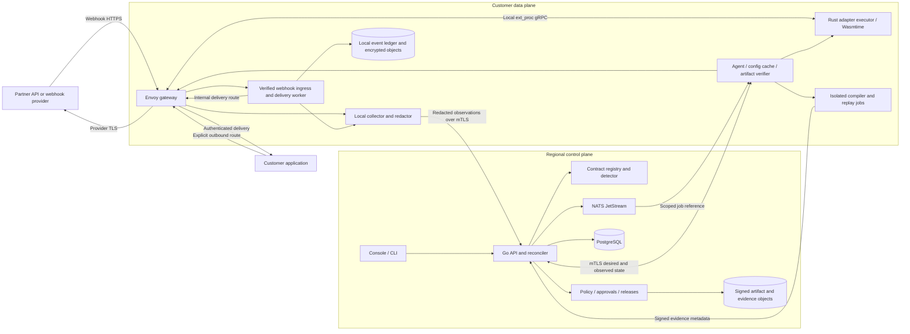
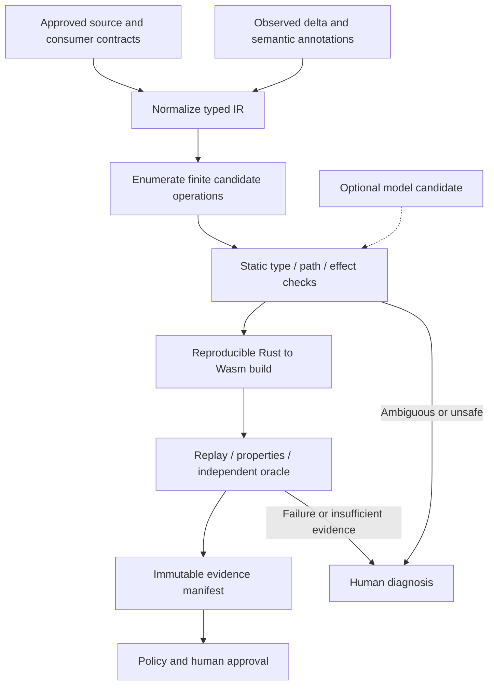
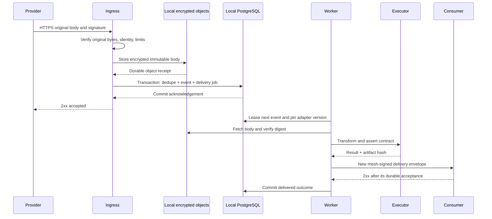
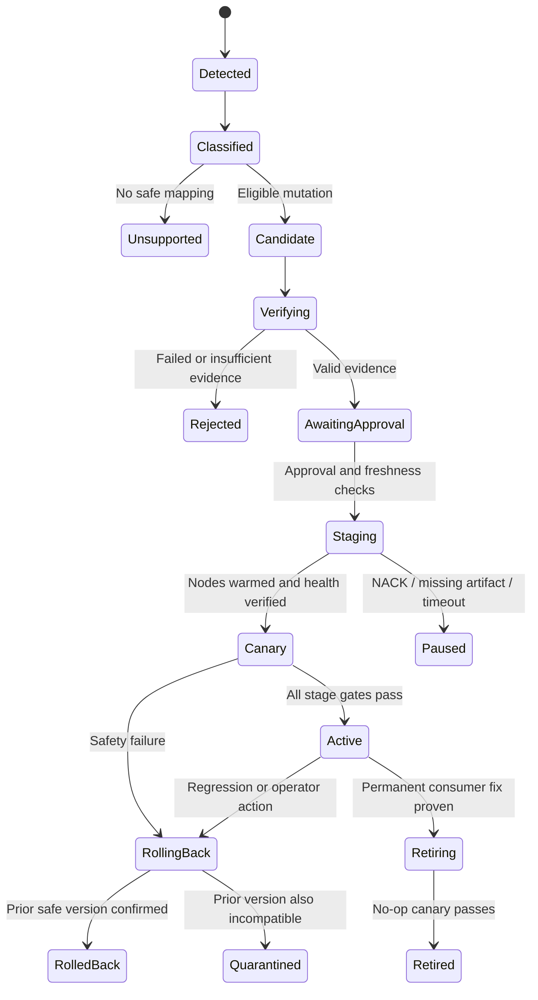

# Architecture Specification
# Self-Healing B2B API Mesh & Schema-Drift Compiler

**Status:** Proposed architecture, not an implemented system.  
**Prepared:** 17 October 2026.  
**Companion documents:** [PRD and feature requirements](prd.md) · [Implementation plan](implementation-plan.md).  
**Source:** [Blueprint PDF](High-Moat%20Startup%20Blueprints%202026%20%281%29.pdf), pages 2, 5, and 8.

**Navigate:** [Topology](#2-topology-and-trust-boundaries) · [Stack](#3-selected-technology-stack) · [Protocols](#4-protocol-contracts) · [Feature flows](#5-end-to-end-feature-flows) · [Live delivery](#6-live-delivery-flows) · [Storage](#8-control-apis-events-and-storage) · [Security](#9-security-and-abuse-resistance).

## 1. Architectural decisions

1. **Separate observation, repair computation, and live delivery.** Synthesis, models, build jobs, and replay never run on a customer request's critical path.
2. **Use explicit application boundaries first.** An Envoy gateway and a verified webhook ingress provide reliable plaintext and routing context. eBPF is a later observation option, not the repair mechanism.
3. **Keep transformation semantics finite and typed.** A versioned DSL compiles to deterministic Wasm. Arbitrary model-generated source is not accepted.
4. **Make the consumer contract explicit.** Observed traffic estimates shape; it cannot establish business truth or prove a field optional.
5. **Start production with an out-of-process Wasmtime executor.** Envoy external processing calls a local Rust service with a narrow Wasm ABI. A Proxy-Wasm execution profile remains an independently qualified optimization.
6. **Store payloads locally by default.** The hosted control plane receives approved metadata and redacted evidence. A private control plane is an R2 deployment option.
7. **Use durable state plus idempotent jobs.** PostgreSQL is authoritative; a transactional outbox and NATS JetStream deliver work at least once. No distributed exactly-once claim is made.
8. **Authorize immutable releases.** A release binds artifact, contracts, policy, evidence, route, environment, and runtime compatibility. Rollout is a state machine with independent health feedback.

### 1.1 Corrections and refinements to the blueprint

| Blueprint shorthand | Engineering interpretation |
|---|---|
| Zero-latency shadow tap | Observation has CPU, memory, copying, and scheduling overhead; measure it and decouple export from forwarding. |
| eBPF at sockets reads TLS payloads | Encrypted sockets expose ciphertext. Plaintext needs a qualified application/TLS hook or explicit termination boundary. |
| AST schema diff | Parse JSON/OpenAPI into a typed contract graph; use source-code AST tools only for later source edits. |
| Wasm / Component Model / Envoy interchangeability | These are different host interfaces. A Wasmtime core module with our ABI is not a drop-in Proxy-Wasm module or a component. |
| Replay proves correctness | Replay proves properties against a particular oracle and corpus. Independent semantic assertions and held-out cases remain necessary. |
| Hot swap is atomic everywhere | Version assignment is atomic per request/event; fleet propagation is asynchronous and must be observed. |
| ClickHouse payload ring buffer | Use local bounded buffers plus encrypted object storage for samples; ClickHouse, if added, stores analytical metadata. |
| All 4xx/5xx imply schema repair | Authentication, rate limiting, outages, business errors, and malformed contracts are distinct incident classes. |

The [Proxy-Wasm specification](https://github.com/proxy-wasm/spec) defines a proxy extension ABI. The [Component Model documentation](https://component-model.bytecodealliance.org/design/components.html) describes a different interface/composition model. This architecture uses separate wrappers around shared transformation semantics rather than assuming binary interchangeability.

## 2. Topology and trust boundaries



The diagram contains two independent traffic paths: partner → verified ingress → asynchronous internal delivery, and application → outbound gateway → provider. Separate listeners/routes prevent a webhook delivery from re-entering ingress. An agent pulls tenant-scoped jobs through the control API; customer networks do not require direct access to the control-plane NATS broker.

### 2.1 Deployment units

| Unit | Responsibility | Initial process boundary |
|---|---|---|
| Control API/reconciler | Tenancy, connector config, contracts, incidents, approvals, releases, audit, outbox | One modular Go service with separated packages and database access policies |
| Control workers | Detection aggregation, job dispatch, notification, usage, GitHub sync | Same Go codebase; separate worker processes |
| Compiler | Contract IR, DSL validation, deterministic synthesis, code generation | Rust command/service executed in isolated jobs |
| Verification worker | Corpus construction, oracle checks, property tests, Wasm execution, evidence signing | Isolated Rust worker in customer data plane by default |
| Data-plane agent | Enrollment, local config/artifact cache, desired-state reconciliation, health export | Go daemon |
| Webhook service | Original signature verification, durable acceptance, dedupe, delivery scheduling, new-envelope signing | Go service; separate ingress and worker roles when scaling |
| Adapter executor | Local ext_proc server; validates contracts and runs pure transformations | Rust/Tokio/Tonic process, Wasmtime instances separated by artifact/tenant |
| Envoy | TLS routing, connection management, request limits, outbound provider calls, local external processing | Standard supported Envoy distribution pinned by image digest |
| Console/CLI | Operator workflows and automation | React/TypeScript static web app; Go CLI |

R0 may run these units on one developer machine using containers and loopback transport. R1 separates the live gateway/executor, untrusted compilation/replay jobs, and control plane. A local-process shortcut must never leak into a production deployment profile.

### 2.2 Deployment options

- **Reference pilot:** hosted regional control plane, customer-hosted Linux data plane, local payload store and event ledger, outbound authenticated control connection.
- **Local development:** Docker Compose, PostgreSQL, NATS, filesystem object-store adapter, provider simulators, Go/Rust services, Envoy, and console. Loopback-only plaintext is allowed in the development profile.
- **Customer without Kubernetes:** qualify a Linux VM/container deployment with managed local-region storage; operational procedures remain the same.
- **Enterprise private deployment, R2:** control plane, build/replay services, artifacts, and payload storage inside the customer's cloud. This is not assumed to be air-gapped until offline upgrades, identity, and artifact distribution are implemented.

## 3. Selected technology stack

Exact patches and image digests are chosen and recorded during the week-1 compatibility spike. “Latest” is never a deployment version. These are design selections, not claims that the repository already contains dependencies.

| Layer | Selected technology | Reason / constraints |
|---|---|---|
| Live routing | Envoy with xDS v3 | Explicit route management, HTTP/1.1 + HTTP/2, TLS, mature proxy operations |
| Adapter execution | Rust + Wasmtime core Wasm modules | Deterministic transformations, memory isolation, fuel/epoch interruption, narrow host surface |
| Envoy integration | Local ext_proc gRPC service using Tonic/Prost | Execution can be resource-limited outside Envoy worker threads; qualify latency before pilot |
| Optional embedded execution | Rust Proxy-Wasm SDK + compatible Envoy runtime, prefer included V8 for comparison | R2 optimization; separate artifact and host qualification |
| Compiler/parsing | Rust, serde/serde_json with exact-number handling, YAML parser, JSON Schema validator, custom typed IR | Direct schema semantics; no dependency on source-code parsing for payload transformations |
| Property/fuzz testing | proptest, cargo-fuzz, mutation fixtures | Find coercion, path, collision, parser, and boundary errors |
| Control plane/agent/CLI | Go, net/http, gRPC, pgx/sqlc, explicit SQL migrations | Strong network tooling and simple deployment; one API ownership model |
| Transactional state | PostgreSQL | Tenancy, contracts, releases, delivery ledger, dedupe, audit, outbox |
| Work transport | NATS JetStream | Durable work delivery; consumers still use database idempotency |
| Artifact/payload storage | AWS S3 in selected region; customer-owned bucket for payloads | Encryption, versioning/lifecycle policies, content-addressed objects; local filesystem adapter for development only |
| Analytics | PostgreSQL initially; ClickHouse in R2 if measured query/volume thresholds justify it | Avoid a second analytical database before demand; payload bodies stay out of analytics |
| Identity | OIDC login through existing customer IdP, scoped service identities, local mTLS PKI | Avoid custom password handling; SAML/SCIM through enterprise integration in R2 |
| Secrets/signing | AWS Secrets Manager + KMS in reference deployment; customer equivalent through interfaces | Secret references, envelope encryption, key rotation, artifact/evidence signing |
| Console | React + TypeScript + Vite, TanStack Query, accessible component primitives | Operator-focused SPA; server authorization always authoritative |
| Telemetry | OpenTelemetry, Prometheus, Grafana; structured JSON logs | Shared traces and metrics without recording sensitive bodies |
| Delivery/infrastructure | Docker, Kubernetes/Helm for hosted control plane, Terraform, GitHub Actions | Reproducible environments, digest-pinned releases, promotion checks |
| Git integration | GitHub App | Installation-scoped repository access and traceable PR creation |
| Optional model assistance | Provider-neutral structured-output API; disabled initially | Select a model only after a held-out benchmark and data-policy review; no hard-coded 2026 model recommendation |
| eBPF, R2 | Rust + Aya, Linux BTF/CO-RE where applicable | Reuse Rust; platform-specific user-space TLS offsets still need independent qualification |
| Source-code edits, R2 | Tree-sitter for supported language parsers | Useful for permanent-fix edits; unnecessary for the initial contract compiler |

No Redis, Kafka, service-mesh replacement, vector database, or workflow orchestration platform is required for the initial release. PostgreSQL leases, an outbox, JetStream, and a reconciler are sufficient for the bounded workflow; revisit only when measured complexity warrants it.

### 3.1 Runtime qualification decision

Envoy's current [Wasm filter reference](https://www.envoyproxy.io/docs/envoy/latest/api-v3/extensions/filters/http/wasm/v3/wasm.proto) explicitly qualifies its production experience and security posture. The pilot therefore uses a local executor reached through [Envoy external processing](https://www.envoyproxy.io/docs/envoy/latest/configuration/http/http_filters/ext_proc_filter), which exchanges request/response processing messages over gRPC. This is our architectural risk decision, not a claim that external processing removes all security or performance risk.

The prototype must demonstrate the blueprint's Envoy Proxy-Wasm path in a laboratory comparison if feasible, but passing that demonstration does not authorize production use. If ext_proc fails the latency or behavior gates, pause affected production scope and revisit the host choice; do not silently weaken the gates.

## 4. Protocol contracts

### 4.1 Network and message protocols

| Link | Protocol | Authentication / guarantees |
|---|---|---|
| Browser/CLI → control API | HTTPS REST/JSON `/v1`, OpenAPI-described | OIDC session or scoped service token; browser cookie CSRF protection; server-side role checks |
| Agent → control plane | gRPC over TLS, mTLS | Tenant/environment derived from certificate enrollment, not caller-supplied IDs |
| Agent → local Envoy | xDS v3 ADS over local authenticated channel | Dedicated management identity; version/nonce bookkeeping; restricted admin endpoint |
| Envoy → executor | ext_proc bidirectional gRPC over UDS where qualified, otherwise loopback mTLS | Only local gateway identity; explicit deadlines; bounded buffered JSON mode |
| Provider → webhook ingress | HTTPS; provider-native signature verification | Signature over original bytes and applicable timestamp checks before parsing/transforming |
| Mesh → consumer webhook | HTTPS/mTLS + mesh-signed envelope | New trust contract; receiver dedupes stable event identity and verifies mesh signature |
| Outbound application → gateway → provider | HTTP/1.1 or HTTP/2, TLS to provider | Explicit reverse-proxy/base-URL or connector integration; server certificate validation; no silent TLS interception |
| Control service → JetStream | NATS protocol over TLS, account/subject permissions | At-least-once delivery; no raw payloads or credentials in job messages |
| Local store / artifact fetch | HTTPS object-store APIs | Workload identity; tenant-bound object prefixes; digest/signature validation |
| Optional model → candidate service | HTTPS provider API | Scoped credentials; approved sanitized input only; schema-constrained response |

HTTP/2 transport support does not imply gRPC payload support. Protobuf messages need descriptors, framing, and method-level semantics. Browser WebSockets and indefinite streaming bodies remain passthrough/unsupported for transformation until independently implemented.

### 4.2 HTTP details and limits

- R1 transforms complete UTF-8 JSON bodies up to 256 KiB and nesting depth 64. Benchmark claims use 32 KiB bodies; larger supported bodies receive separate performance results.
- Detect duplicate JSON keys, invalid UTF-8, nonfinite numbers, oversized arrays, excessive depth, and parser resource exhaustion; reject as ineligible evidence. Preserve number tokens or exact decimal values, never route critical values through a JavaScript double.
- Validate content type, transfer framing, and status before parsing. A `204`, `304`, `HEAD`, empty body, HTML error page, or malformed JSON must not be sent to a JSON transformation by accident.
- Compressed signed webhooks are unsupported initially unless the connector defines the exact signed representation. Reject them before acceptance. Outbound compressed bodies are pass-through unless bounded decompression/recompression is separately qualified.
- After transformation, recompute content length/framing and clear or recompute affected content digests/ETags. Never forward an original payload signature as authentication of new bytes. Signed outbound bodies are observation-only unless an explicitly authorized signing workflow exists.
- Preserve unrelated headers using an allowlist policy; remove hop-by-hop and spoofable internal identity headers at trust boundaries. Route destinations come from trusted configuration, never a body field or arbitrary URL supplied by a model.
- Chunked bodies are assembled within byte/time limits; partial captures and timeouts are recorded as incomplete, not learned as a new schema. Transparent streaming transformation is out of scope.

### 4.3 Contract formats

Use [OpenAPI 3.1.1](https://spec.openapis.org/oas/v3.1.1.html) and [JSON Schema 2020-12](https://json-schema.org/draft/2020-12) as explicit import targets, with a documented supported subset. Supporting that subset does not mean full dialect conformance. Common OpenAPI 3.0 constructs such as `nullable` are normalized with visible diagnostics. Unsupported keywords are blocking diagnostics when they affect repair proof.

Resolve local `$ref` values into a graph with cycle and size bounds. Remote references require a preconfigured allowlist, fetched content hash, and offline cache; default is disabled. Treat `oneOf`, `anyOf`, discriminators, `additionalProperties`, requiredness, formats, and read/write direction explicitly. Reject unresolved or ambiguous unions for automatic synthesis. Format checks such as date-time are assertions only where policy enables their specific semantics.

## 5. End-to-end feature flows

### 5.1 Enrollment and route setup — F01, F02, F25

1. A tenant administrator creates an environment and a single-use short-lived enrollment credential.
2. The agent exchanges it for an environment-bound identity, then receives only the routes, policy, and artifact manifests for that environment.
3. It verifies local dependencies, destination allowlists, secret references, storage policy, DNS/TLS reachability, and supported body types.
4. The engineer imports an intended consumer contract and supplies provider/account/version information. The connector records credential scope but never uploads secret values.
5. The agent reports capability versions and a readiness result. Observe mode starts only for approved routes. Production mutation permissions are a separate policy.
6. Certificate rotation overlaps old/new identities; revocation blocks new configuration retrieval and flags the agent. Cached execution follows local incident policy rather than silently accepting new releases.

### 5.2 Capture and redaction — F03, F04, F20

Capture metadata at the TLS/application boundary: route template, method, status, content type, provider version, timings, stable event/request identity, shape fingerprint, capture quality, and adapter identity. Never use a full URL containing query tokens as a metric label.

For an explicitly proxied supported route, local schema validation can run on every bounded JSON body. Full payload sampling is separate: default 1% normal traffic, elevated capture for anomalies within configured byte/rate budgets. Passive/eBPF mode only detects what it captures; the UI reports its lower coverage.

Raw bytes remain in short-lived local memory unless persistence is permitted. Before export, strip secrets and apply path-based redaction or stable tenant-keyed tokenization. Redaction can destroy useful evidence; mark fields whose semantic verification is unavailable and require local verification. Never convert redacted placeholders into inferred real enum values.

The local collector uses a bounded memory/disk spool. When its quota is reached, drop telemetry samples with counters; do not drop already accepted webhook work. Queued observations include capture completeness and sample probability so incident estimates can show uncertainty.

### 5.3 Contract normalization and drift detection — F04, F05, F06

Normalize each schema into an IR containing node kind, property names, requiredness, nullability, exact numeric constraints, arrays, unions, semantic annotations, and source provenance. Canonicalize the normalized representation and hash it without erasing meaningful distinctions.

Partition observations by tenant, environment, route, direction, event family, provider version, and consumer contract. Build observed-shape histograms independently from the approved baseline. API version changes create a new cohort; do not merge incompatible versions into one inferred schema.

Compatibility direction matters:

- For a response/webhook, transform a provider value into a value accepted by the consumer contract.
- For a request, transform a consumer-produced value into one accepted by the provider contract. Request transformation ships later and needs stronger side-effect controls.

The detector emits typed changes: added/removed property, requiredness change, nullable change, nested-path change, type/enum constraint change, status/body mismatch, or sequence anomaly. A rename is a hypothesis until backed by provider documentation, customer annotations, or an approved mapping. Similar names alone are insufficient.

A mismatch opens provisional evidence immediately. Default aggregation confirms a recurring structural incident after three complete qualifying observations within five minutes; one protected-invariant violation or explicit contract-version diff may open an immediate high-severity incident. Low-volume singletons remain visible. Error-rate windows use denominators and minimum counts; traffic gaps suppress healthy status.

### 5.4 Deterministic synthesis — F07, F08, F09, F22



Synthesis searches a bounded grammar. R0 limits candidates to at most eight operations, 20 candidate plans, and 30 seconds of search per incident; quotas are configurable. Exhaustion returns `SEARCH_LIMIT` instead of choosing an unverified plan. Rank candidates by preserved semantics, evidence, then minimal operation count; ranking never overrides mandatory checks.

Each operation has a precondition, effect set, and postcondition. The compiler rejects multiple writes to the same destination, cyclic moves without explicit temporary handling, wildcard explosion, conflicting union branches, missing source fields, implicit default values, and unsupported formats. An adapter has a guard for its input shape/version. Nonmatching input yields a declared no-op only if it already satisfies the target contract; otherwise it yields an incompatibility error.

Illustrative synthetic DSL, not a claim about a real provider mutation:

```yaml
apiVersion: mesh.example/v1alpha1
kind: Adapter
metadata:
  name: shipment-tracking-v2-to-v1
spec:
  route: partner.shipment-updated
  direction: webhook
  sourceContract: sha256:SOURCE_CONTRACT_DIGEST
  targetContract: sha256:CONSUMER_CONTRACT_DIGEST
  semanticEvidence: annotation:tracking-identifier-equivalence-v1
  guard:
    requiredPaths: [/shipment/tracking/number]
    absentPaths: [/shipment/tracking_number]
  operations:
    - op: move
      from: /shipment/tracking/number
      path: /shipment/tracking_number
      sourceType: string
      targetType: string
      onMissing: reject
      onConflict: reject
  assertions:
    - kind: valueEqual
      before: /shipment/tracking/number
      after: /shipment/tracking_number
    - kind: unchangedOutside
      paths: [/shipment/tracking/number, /shipment/tracking_number]
  unmatchedInput: validate_target_or_reject
```

The target schema must permit the remaining empty `tracking` object, or an explicit separately checked removal is required. JSON Pointer escaping is mandatory; arrays cannot be rearranged merely to satisfy a shape. Defaults require explicit contract authorization and cannot substitute for missing business values.

Optional models receive only approved schema fragments, mutation metadata, and permitted examples. Their output is parsed as DSL, never executed as instructions. They have no deployment credentials or generic network/tool access. Persist model/provider/prompt-template versions and sanitized input hashes for evaluation, with raw prompt retention controlled by tenant policy.

### 5.5 Wasm build and execution — F07, F10, F12

Use one shared Rust transformation library and two separate host wrappers:

1. **Production initial wrapper:** core Wasm module, compiled for a pinned compatible target such as `wasm32-unknown-unknown`, exposing a small versioned byte-oriented ABI.
2. **Experimental embedded wrapper:** Proxy-Wasm callbacks around the same semantics, compiled and tested independently. It has a different artifact hash and host contract.

Initial ABI exports: `abi_version`, bounded `alloc`, `dealloc`, and `transform`. Input is a length-delimited envelope of route context plus body; output contains `unchanged`, `transformed`, or a structured rejection and resulting body. Define pointer ownership and maximum lengths in the ABI schema; host validates every range and return code. There are no filesystem, clock, random, environment, secret, or network imports. A transform is a pure function of input and immutable configuration.

Compiler jobs run with a read-only toolchain/dependency cache, no network, nonroot identity, CPU/memory/time limits, and a disposable writable directory. Do not run arbitrary customer `build.rs`, packages, shell commands, or model source. Build only our audited templates plus validated DSL constants. Generate an SBOM and build manifest; compare repeat builds before claiming reproducibility.

Executor limits: 32 MiB Wasm linear memory per active instance initially, a calibrated fuel allowance, epoch interruption, maximum 64 concurrent transformations per executor process, and a bounded waiting queue. The starting per-transform wall deadline is 10 ms and ext_proc deadline 25 ms; tune only through versioned policy and benchmarks. Limit Go/Rust/native parsing allocations too; Wasm memory limits do not bound all host memory.

Avoid sharing mutable instance state across events or tenants. Pool instances only with a proven reset mechanism; otherwise instantiate/prewarm an isolated instance. Request context pins artifact, policy, and contract hashes before processing starts. Restrict executor egress and secrets even though the Wasm imports are empty. Wasmtime's [security model](https://docs.wasmtime.dev/security.html) informs the sandbox, but OS isolation and host implementation remain part of the trusted computing base.

### 5.6 Verification and evidence — F09, F10, F11

The replay oracle is independent of the candidate. It combines the approved consumer contract, owner-authored assertions, expected golden outputs where available, and explicit business invariants. Comparing the candidate to its own generated output is not a valid oracle.

Required layers:

1. Parse/type/path checks and operation-effect analysis.
2. Artifact import/export, ABI, signature, size, and runtime-limit checks.
3. Golden tests for old valid traffic, new drifted traffic, ambiguous mixed shapes, and malformed values.
4. Properties: determinism; preserved values outside the effect set; no invented required data; exact numerical round trips where applicable; idempotent guarded application where the DSL declares it.
5. Differential tests between native shared core, Wasmtime wrapper, and experimental Proxy-Wasm wrapper if offered.
6. Side-effect-free replay through a simulated downstream validator; all external egress denied.
7. A holdout corpus never exposed to the synthesis step, split by event/entity/time where feasible to avoid duplicate leakage.
8. Memory, deadline, parser-fuzz, crash, and concurrent-load checks.

Default eligibility policy: at least 1,000 total replay executions, including at least 100 distinct real/sanitized events with 20 held out, all declared schema/semantic variants, and at least 50 adversarial/negative cases. Generated cases may increase execution count but must be labeled and may not masquerade as distinct production evidence. Low-volume routes require an explicit human waiver listing the missing coverage; they remain ineligible for automatic repair. Negative cases pass when they produce the specified rejection, not when they return a successful payload.

An evidence manifest records source/target/DSL/artifact/policy hashes, fixture manifest hash, corpus origin and exclusions, redaction policy, toolchain/runtime versions, tests and outcomes, coverage gaps, reviewer annotations, and timestamp/expiry. Default evidence validity is 24 hours; any contract, policy, runtime-compatibility, or material observed-shape change invalidates it sooner. A local verification identity signs the manifest; deployment verifies it against the environment's trusted verifier keys.

## 6. Live delivery flows

### 6.1 Signed asynchronous webhook path — F12, F13, F14



**Signature boundary:** verify provider authentication before transformation. Keep the raw body digest and original provider verification result as provenance. A consumer using its existing provider-signature middleware unchanged must remain on pass-through/observe mode. To enable transformation, it adopts the mesh signature/envelope or integrates a post-verification adapter into its own application.

**Acceptance transaction:** store the encrypted raw body first, then atomically insert the event record and delivery job with a unique key. If the DB transaction fails, return a retryable error and garbage-collect unreferenced objects. If the response to the provider is lost after commit, the duplicate request resolves to the existing accepted event. Require the configured replicated database commit and durable object-store acknowledgement before success. No broker publish is required before provider acknowledgement; a reconciler finds committed pending rows.

**Deduplication:** key by tenant, environment, provider account, destination/route, event type, and provider event ID as specified by the connector. Track delivery IDs separately from logical event IDs. Same event ID with a different raw-body digest is an integrity incident, not an automatic duplicate. Keep dedupe tombstones for 30 days by default, independent of body deletion. For providers without an event ID, document a bounded hash-based fallback and its collision/legitimate-repeat limitations.

**Delivery semantics:** at least once. A consumer must commit its inbox dedupe key and business change atomically if it wants effectively-once application effects. The mesh cannot ensure this for an arbitrary endpoint. If a worker crashes after downstream acceptance but before marking success, retry with the same logical event ID and frozen transformed data/artifact. An attempt envelope may receive a fresh timestamp/signature, but the transformed data and its digest remain fixed. Never regenerate an already-attempted delivery under a different adapter automatically.

**Ordering:** do not infer provider ordering from arrival. Serial processing per configured entity key preserves local order only. For version-sensitive consumers, require an explicit version/timestamp policy and reconciliation mechanism; without it, expose ordering as unspecified. Shopify describes ordering limitations and delivery identity in its [webhook overview](https://shopify.dev/docs/apps/build/webhooks).

**Acknowledgement scope:** durable-ack mode is only for asynchronous event notifications where provider semantics permit acceptance before business processing. Interactive authorization webhooks and endpoints whose response controls provider behavior are excluded until a synchronous connector is qualified.

### 6.2 Mesh delivery signature

Define a versioned envelope containing `tenant_id`, `environment_id`, `route_id`, stable `event_id`, stable `delivery_id`, provider/account/type/version, original-body hash, adapter hash, target-contract hash, verification time, transformed `data`, and its stable `data_sha256`. Include `issued_at`, `attempt_id`, and destination `audience` for the current delivery attempt. Persist the exact serialized transformed data before first delivery; attempt metadata is outside its digest.

Use compact JWS with detached content as defined in [RFC 7515, Appendix F](https://www.rfc-editor.org/rfc/rfc7515#appendix-F). The detached payload is the **exact transmitted envelope bytes**, using standard base64url payload encoding. A vetted JOSE library signs the encoded protected header plus encoded payload; transmit the signature as `X-Mesh-Signature: <protected-header>..<signature>`. Protected headers include an allowlisted algorithm, `kid`, and a versioned mesh media type. The receiver reconstructs the JWS payload from raw HTTP body bytes before JSON parsing. Do not normalize or reserialize the received JSON before verification.

Receiver checks algorithm, tenant/environment key binding, audience, timestamp tolerance, and dedupe identity; a duplicate identity with a different transformed-data digest is an integrity incident. Publish verification keys in [JWK Set format](https://www.rfc-editor.org/rfc/rfc7517) at a configured authenticated endpoint. Never follow an arbitrary key URL from an incoming header. Rotate with overlap and refuse unknown/revoked keys. The reference deployment uses KMS-backed asymmetric signing; development uses disposable local keys. Original provider signatures are protected provenance only, never authentication of transformed bytes.

### 6.3 Synchronous outbound response path — F12, F15

1. Application explicitly addresses an allowlisted gateway route using its configured base URL or connector integration.
2. Envoy validates the caller, applies route limits, and forwards once to the provider with the existing credential policy and provider TLS verification.
3. The response is bounded and classified. A supported JSON response invokes local ext_proc; status-only failures go to operational classification instead.
4. Executor pins the approved adapter, verifies input guard, transforms, validates output and protected invariants, then returns replacement bytes/headers.
5. Envoy returns the response and emits redacted observations asynchronously.

No model, database lookup, or remote control-plane call is required for the synchronous transform. Secret refresh and configuration delivery happen outside this path. On executor failure, apply the route's predeclared behavior. If the upstream already performed a write, an adapter error cannot undo it; return an explicit ambiguous-outcome status to a qualified client and do not retry the write. R1 therefore limits outbound qualification to read-only operations.

### 6.4 Retries, limits, authentication, and pagination — F15, F16

Webhook delivery retries use exponential backoff with jitter, bounded by attempt and age limits: initial policy 10 attempts over at most 24 hours, then DLQ within the seven-day retention window. Honor a valid Retry-After subject to the event deadline. Authentication/configuration failures pause and alert instead of creating a rapid retry loop. Manual redelivery is an explicit action preserving event identity and reviewing downstream idempotency.

Synchronous proxy retries are disabled by default. An owner may enable at most two retries for verified read-only/idempotent operations within an overall deadline. HTTP method alone is insufficient evidence of safety. Preserve provider idempotency keys across authorized retries; an ambiguous non-idempotent timeout requires reconciliation.

A provider pack describes quota scope: token, account, endpoint, or concurrency pool. Coordinate a small number of local scheduler leases through the local ledger for account-wide limits; a per-process token bucket alone is not a global guarantee. Never invent a provider's quota or claim control over traffic bypassing the mesh. NetSuite account concurrency must be discovered/configured using its [governance documentation](https://docs.oracle.com/en/cloud/saas/netsuite/ns-online-help/section_1500275531.html).

OAuth refresh uses the tenant-configured flow and scopes, distributed single-flight/lease control, encrypted secrets, and compare-and-swap on token generation. A 401 triggers diagnosis or one configured refresh, not permission expansion. NetSuite REST uses separately authorized production/sandbox configurations; see [Oracle OAuth documentation](https://docs.oracle.com/en/cloud/saas/netsuite/ns-online-help/section_157780312610.html).

Pagination diagnostics record cursor hash, page index, stable entity IDs, termination signal, and checkpoint. R2 sequence adapters must preserve no-loss/no-duplication invariants against multi-page fixtures, checkpoint only after durable processing, detect token loops, and cap pages/time. Switching cursor/offset semantics is never proven by a single JSON-body test. Cross-call state belongs in a connector workflow, not a stateless Wasm transform.

## 7. Release control and rollback — F11, F12, F13, F26



### 7.1 Signed release manifest

Bind tenant/environment/route, monotonic generation, artifact and manifest hashes, source/target contracts, evidence ID/hash, policy version, compatible executor/ABI versions, authorized approver, approval expiry, canary configuration, and previous safe release. The deployment signer only signs approved eligible releases. Nodes reject wrong-tenant, expired-for-installation, revoked, unsupported, or older-generation configuration unless an explicit rollback manifest authorizes that older artifact under a new generation.

Approval expiry controls new installations/promotions; it does not automatically remove a healthy active adapter. Active review deadlines generate alerts and freeze new promotion. Emergency security revocation is a separate signed action with an explicit stop/quarantine policy.

### 7.2 Distribution and xDS

The control plane publishes desired state through a PostgreSQL transaction/outbox. An agent prefetches artifacts, verifies signatures/digests, warms the executor, checks health, and applies a generation to its local Envoy/config service. The agent records both desired and observed state.

Track xDS resource versions, stream nonce, ACK/NACK, executor artifact readiness, and real request-level version metrics. An ACK alone is insufficient proof of applied healthy configuration; this follows the [xDS protocol's documented semantics](https://www.envoyproxy.io/docs/envoy/latest/api-docs/xds_protocol). Do not assume multiple xDS resources update atomically. Gate traffic assignment on the entire local generation being ready.

Use stable stream/event assignment: pin the release at request start or first delivery attempt. Retain the previous module until in-flight work completes. Nodes missing a generation are excluded from candidate assignment where routing permits; otherwise stop promotion and surface mixed-version status.

### 7.3 Canary policy

Default rollout: 1% → 5% → 25% → 100% of eligible traffic. Use deterministic hashing of stable event/entity identity so retries and ordered entity streams remain in one cohort. A live request is processed once; comparison executes on an isolated copy without downstream side effects.

Each stage requires both at least ten minutes and 100 eligible candidate executions, zero protected-invariant failures, zero signature-integrity failures, no unexpected runtime traps, and healthy downstream acceptance. Stop if error rate increases by more than one percentage point with adequate sample count, or p95 added latency exceeds the qualified budget. Initial thresholds are configuration defaults that must be calibrated in pilot; rare traffic cannot auto-promote on a timer.

Lack of canary telemetry pauses promotion. Where the prior version still works, use it as control. During total upstream breakage, do not intentionally send broken control traffic merely for comparison; use quarantined/isolated baseline evidence and an approved recovery rollout with explicit reduced-confidence labeling.

### 7.4 Recovery behavior

Stop assigning new requests/events to the bad artifact, mark relevant in-flight outcomes, and issue a new generation pointing to the prior safe artifact. If upstream drift means the prior artifact cannot satisfy the consumer, route to quarantine or explicit incompatibility error. Retrying a delivery with a new artifact requires a reviewed redelivery record, never rewriting history. Rollback changes future processing only; downstream reconciliation is a separate customer action.

Agent exposes a local authenticated emergency command to pause repair or quarantine a route when the control plane is unavailable. Every emergency action is logged locally and reconciled later. Agent disconnection blocks new release installation and promotion; cached valid artifacts continue according to policy.

## 8. Control APIs, events, and storage

### 8.1 Public management API — F01–F22, F25, F26

The following are proposed contracts to implement, not existing endpoints. All paths inherit the caller's authorized tenant context; an arbitrary `tenant_id` request field cannot override it.

| Endpoint | Action / concurrency behavior |
|---|---|
| `POST /v1/projects`, `/v1/environments` | Create scoped resources; idempotency key required |
| `POST /v1/integrations`, `POST /v1/routes` | Register connector and exact route/delivery policy |
| `POST /v1/agents/enrollment-tokens` | Issue short-lived single-use enrollment token |
| `POST /v1/contracts` | Upload bounded schema; return normalized hash and diagnostics |
| `GET /v1/incidents` / `GET /v1/incidents/{id}` | Cursor-paginated incident/evidence view |
| `POST /v1/incidents/{id}/candidates` | Request deterministic synthesis; return job ID |
| `POST /v1/candidates/{id}/verifications` | Start local replay with an immutable corpus manifest |
| `POST /v1/candidates/{id}/approvals` | Approve exact artifact/evidence/policy tuple |
| `POST /v1/releases` | Create scoped rollout; require approval and expected route generation |
| `POST /v1/releases/{id}/pause` / `/rollback` | Idempotent operational action with reason |
| `GET /v1/routes/{id}/deliveries` | Metadata-only queue view unless explicit payload permission |
| `POST /v1/deliveries/{id}/redeliver` | Reviewed replay of business delivery; distinct from verification replay |
| `POST /v1/routes/{id}/retirements` | Start permanent-fix/no-op qualification |
| `GET /v1/audit-events` / `/v1/usage` | Scoped export and usage summaries |
| `POST /v1/data-deletions` | Asynchronous deletion job with scope and progress |

Mutation requests use an `Idempotency-Key`; persist its scope, payload hash, response, and expiry. Reuse with different content yields `409`. Configuration updates require `If-Match`/expected revision; stale writes return `409` or `412`. Long-running work returns `202` with job/status links. API errors include code, safe message, request ID, and retryability, never raw secrets.

### 8.2 Agent RPC and internal events

Proposed agent RPCs: `Enroll`, `Heartbeat`, `StreamDesiredState`, `UploadObservations`, `LeaseVerificationJob`, `ReportVerification`, `ReportDeployment`, and `DownloadArtifactManifest`. Bind every request to certificate-derived tenant/environment and validate object ownership. Cap message sizes and batches. Heartbeats carry executor/Envoy versions, queue pressure, current generations, and capture quality.

Internal event envelope:

```json
{
  "event_id": "uuid",
  "event_type": "verification.completed.v1",
  "schema_version": 1,
  "tenant_id": "tenant-reference",
  "environment_id": "environment-reference",
  "aggregate_id": "candidate-reference",
  "aggregate_revision": 4,
  "occurred_at": "RFC3339 timestamp",
  "trace_id": "trace-reference",
  "payload_ref": "authorized-object-reference",
  "payload_sha256": "digest"
}
```

Subject families: `observation.v1`, `drift.v1`, `candidate.v1`, `verification.v1`, `release.v1`, `audit.v1`, and `usage.v1`, partitioned by trusted tenant shard where needed. Authorization is not delegated to a caller-supplied subject name.

Update domain state and an outbox row in one PostgreSQL transaction. A dispatcher publishes and marks sent only after broker acknowledgement. Consumers use a unique inbox key `(consumer, event_id)` and revision guards; acknowledge only after database commit. Retries may duplicate publication and processing attempts. [JetStream](https://docs.nats.io/concepts/jetstream) provides persistence and delivery mechanisms; application-side idempotency remains necessary across databases, APIs, and customer side effects.

### 8.3 Data model

| Entity / store | Key fields and invariants |
|---|---|
| `tenants`, `projects`, `environments`, `memberships` / control PostgreSQL | Tenant-owned composite identities; role/environment scope; identity issuer and subject |
| `integrations`, `routes`, `provider_accounts` / control PostgreSQL | Owner, connector version, host/path/event selectors, secret reference, delivery policy, contract binding |
| `contracts`, `contract_versions` / metadata + object store | Immutable source + normalized hash, dialect, provenance, supported-keyword diagnostics |
| `observations` / local buffer + redacted control metadata | Shape, version, quality, sample probability, safe payload reference, retention deadline |
| `incidents`, `drift_events` / control PostgreSQL | Class, fingerprint, severity, affected bindings, first/last seen, evidence status |
| `candidates`, `adapter_artifacts` / PostgreSQL + objects | DSL/artifact hash, compiler/ABI/runtime identity, source/target contracts, operation effects |
| `verification_runs`, `corpus_manifests` / metadata + local objects | Input hashes, unique/holdout counts, invariant outcomes, signer, validity interval |
| `policies`, `approvals` / control PostgreSQL | Versioned policy, approver role, exact approved tuple, expiry, decision reason |
| `releases`, `deployments`, `agent_status` / control PostgreSQL | Generation, desired/observed digest, rollout stage, ACK/health state, previous release |
| `accepted_events`, `deliveries`, `dedupe_keys` / local PostgreSQL | Provider/event/account key, raw hash/ref, accepted time, pinned adapter, output hash/ref, lease, attempts, outcome |
| `outbox`, `inbox`, `job_leases` / relevant PostgreSQL | Unique event keys, fencing token/revision, lease expiry, attempts, retry deadline |
| `audit_events` / append-only logical table + signed export | Actor, action, object revisions, evidence refs, timestamp, previous export digest |
| `usage_events`, `usage_rollups` / PostgreSQL | Unique event/request identity, operation category, count, correction entries |
| `mutation_patterns` / tenant PostgreSQL | Abstract change, prerequisites, outcome labels, provenance, consent scope |

All tenant-owned relations use composite tenant-aware foreign keys and scoped unique constraints. Enforce row-level security with non-owner application roles, `FORCE ROW LEVEL SECURITY` where appropriate, and transaction-local tenant context. PostgreSQL documents owner/bypass caveats in its [row-security guide](https://www.postgresql.org/docs/current/ddl-rowsecurity.html). RLS complements, rather than replaces, API authorization and object-store enforcement.

Row leases carry fencing revisions so an expired worker cannot overwrite a newer worker's decision. Long verification work periodically renews leases; a duplicate result with the same manifest hash is idempotent, while conflicting results trigger review. Never hold an SQL transaction open while compiling, calling a provider, or waiting for human approval.

### 8.4 Retention and capacity

| Data class | Initial retention | Location / deletion rule |
|---|---|---|
| Opt-in raw telemetry samples | 24 hours | Customer encrypted objects; never required for basic forwarding |
| Sanitized replay corpus | Seven days | Local by default; pin only with explicit incident/legal policy |
| Pending/DLQ webhook body | Up to seven days | Operational local store; alert at 24 hours remaining; expiry creates an explicit terminal outcome |
| Successfully delivered body | Purge within 24 hours | Retain only digest/metadata afterward |
| Dedupe tombstones | 30 days | Local ledger; does not imply raw-body retention |
| Incident metadata | 30 days | Control PostgreSQL; redact provider/customer identifiers where feasible |
| Audit metadata | 180 days | Immutable signed export and metadata; no body values |
| Artifacts/contracts referenced by active releases | Until retirement plus rollback window | Never delete an active dependency through a generic TTL |

Backup retention is initially 30 days; deletion removes live data promptly, records tombstones, and expires backups by policy. Restores reapply deletion tombstones before serving users. Do not promise immediate deletion from immutable backups.

Sizing example, not a production benchmark: 500 requests/s × 32 KiB × 1% sampling ≈ 13.2 GiB/day of uncompressed body samples. Full capture would be roughly 1.29 TiB/day. Persisting request and response bodies can double this. Compute encryption, replication, indexes, and delivery-body storage separately. Start with a 20 GiB/day telemetry cap per pilot tenant and 10 GiB local spool; exceeding it drops sample data with metrics. Durable webhook admission uses separate storage watermarks and returns a retryable error before acknowledgement when exhausted.

## 9. Security and abuse resistance

| Threat | Control |
|---|---|
| Cross-tenant evidence/artifact access | Certificate/session-derived scope, composite FKs, RLS, object policy, tenant-bound signatures, negative tests |
| Malicious schema or payload | Parser/ref limits, no arbitrary remote `$ref`, depth/size limits, deterministic DSL, bounded candidate search |
| Model prompt injection | Payloads treated as untrusted data; no model tools or deployment keys; structural output validation |
| Adapter exfiltration or resource exhaustion | No Wasm imports for IO; host egress deny; memory/fuel/deadline limits; OS sandbox |
| Supply-chain compromise | Pinned dependencies/images, isolated build, SBOM, provenance, signature verification, explicit release signer |
| Credential leakage | Local secret manager, no secret capture, safe logs, redaction tests, least-privilege provider scope |
| Forged/replayed webhook | Verify raw signature and provider identity; applicable timestamp policy; ledger dedupe; mesh audience/signature checks |
| SSRF / arbitrary network routing | Trusted host/IP policies, DNS/IP revalidation, blocked metadata/private targets except configured customer ranges; no follow-on redirect to an unapproved host |
| Stale/replayed deployment command | Monotonic generation, approval/evidence freshness, tenant-bound manifests, signed rollback generation |
| Unauthorized production patch | Author/approver separation, RBAC, exact immutable tuple, audit trail, environment boundary |
| Privileged capture compromise | eBPF optional; minimal Linux capabilities, process allowlists, separate node-agent hardening and kill switch |

Secrets needed for provider verification or delivery stay outside the Wasm module. A hosted control plane never needs a webhook signing secret to inspect a redacted schema diff. Audit exports are tamper-evident, not described as physically impossible for every administrator to alter; key custody and immutable object policies are part of the assurance boundary.

## 10. Observability and failure behavior — F13, F18, F20, F21

Metrics: supported/unsupported traffic counts, signature rejects, schema mismatches, capture drops/truncations, redaction failures, executor latency/traps/fuel exhaustion, active artifact/generation, verification duration/failures, job lag, oldest accepted-event age, dedupe hits, DLQ count, downstream acceptance, xDS NACKs, agent disconnection, and usage by category.

Usage accounting writes append-only facts keyed by tenant, route, logical event/request identity, and metric category. Separate protected calls, actual transformations, contract-valid outputs, downstream acknowledgements, replay executions, and storage bytes. Aggregate idempotently from the outbox; reconciliation compares rollups against source facts and records correction entries instead of rewriting history. Webhook retries count as delivery attempts, with one logical-event charge under the pilot billing model. Sampled observation cannot serve as an exact billable call counter: use local complete counters/ledger facts, record gaps, and withhold disputed/incomplete charges. Model/verification quotas limit new background jobs; durable-delivery admission and live-route failure policies remain separate.

Keep high-cardinality event IDs and artifact detail in traces/logs, not unrestricted Prometheus labels. Correlate request/event → incident → candidate → verification → approval → deployment → delivery without copying raw payloads into traces. Alerts route to configured destinations and are deduplicated; alert delivery does not block live traffic.

| Failure | Expected behavior |
|---|---|
| Control API/database unavailable | Existing local configurations continue; no new approval/promotion; reconciliation resumes later |
| NATS unavailable | Transactional outbox accumulates with limits; no event considered published until acknowledged; live transforms continue |
| Collector/export full or unavailable | Drop telemetry samples and raise coverage alerts; preserve forwarding and operational delivery |
| Durable webhook store unavailable/full | Reject new acceptance with retryable error; never acknowledge data that cannot be retained |
| Executor timeout/trap | Observe routes bypass transformation; protected repair routes return a declared error or quarantine; no silent corrupt output |
| Invalid or missing artifact | Refuse installation; keep prior safe generation or quarantine if no safe generation exists |
| Bad candidate or stale approval | Mark ineligible; no distribution |
| Downstream 5xx/timeout | Retry eligible webhook deliveries within policy; preserve identity/body; mark uncertain effects for reconciliation |
| Downstream auth failure | Pause route delivery and alert; do not amplify with an unbounded retry storm |
| Verification job crash | Lease expires; idempotent retry in isolated worker; no release without completed signed evidence |
| Agent partition | Show stale observed state; block promotion; continue cached execution and local emergency controls |
| Region loss | Restore from verified backups within documented RPO/RTO; no claim of zero-loss regional failover in R1 |

Capture uses fail-open behavior for observation. Repair failure behavior is separately chosen per route; a blanket fail-open setting could expose incompatible values. Deployed healthy adapters continue during a metadata outage. Missing telemetry, expired evidence, or stale nodes prevent new promotions.

## 11. Git workflow, permanent fixes, and corpus — F17, F22, F26

After a customer enables the GitHub integration, installation-scoped authentication creates one branch/PR per candidate/repository with DSL, generated wrapper or integration example, sanitized fixtures, evidence hashes, and a deployment link. Grant contents/PR permissions only for selected repositories; do not grant workflow modification unless a later explicitly requested feature requires it. GitHub documents installation authentication in its [App guide](https://docs.github.com/en/apps/creating-github-apps/authenticating-with-a-github-app/authenticating-as-a-github-app-installation).

PR creation is idempotent by candidate/repository and records repository/base/head SHA. Conflicts pause source synchronization without changing the live route. Webhook signatures authenticate GitHub events. PR merge is not evidence that the customer deployed the fix. Retirement requires the new consumer contract, deployed consumer version or owner attestation, replay proof of pass-through compatibility, and a no-op canary.

Mutation library entries contain abstract schema deltas, rule prerequisites, test templates, and outcome labels. Tenant-local patterns are reusable by default; cross-tenant sharing requires explicit consent and removal of proprietary schema identifiers as well as payload values. A common pattern helps candidate generation but never grants deployment authority or substitutes for local verification.

## 12. eBPF and protocol expansion — F23, F24

An eBPF agent is a Linux node/host process, commonly deployed as a DaemonSet, not a universally portable unprivileged sidecar. Use Aya to collect bounded process/network observations; [Aya's guide](https://aya-rs.dev/book/) covers Rust eBPF development. Userspace probes depend on target executable/library offsets and interfaces; the [Linux uprobe documentation](https://docs.kernel.org/trace/uprobetracer.html) describes this attachment model.

Qualification must cover kernel/BTF availability, required capabilities, architectures, OpenSSL library builds, Go runtime/library variants, static/stripped binaries, process restarts, file-descriptor reuse, HTTP/2 stream correlation, multiplexing, compression, and ring-buffer loss. CO-RE support does not stabilize every userspace TLS ABI. Never assume a TCP connection equals one HTTP request.

Agent output includes `complete`, `truncated`, `uncorrelated`, or `unsupported` capture quality. Only complete reconstructed messages enter contract evidence. A passive agent can detect a change but cannot modify a provider response by itself; healing still requires the explicit gateway or post-verification application adapter.

For unary gRPC, ingest a pinned Protobuf descriptor set, compare field numbers/types/presence/oneofs, and preserve unknown fields according to the selected codec contract. For GraphQL, qualify named operations with explicit request and response selections; a schema field addition is not automatically a breaking operation change. SOAP/XML and streaming protocols require new parsers and safety models and remain outside the initial expansion commitment.

## 13. Architecture decision log and validation gates

| ADR | Decision | Revisit trigger |
|---|---|---|
| A01 | Explicit Envoy/webhook boundary before eBPF | Partner adoption blocked by proxy/app integration and supported Linux matrix validated |
| A02 | Wasmtime behind local ext_proc for initial production | Measured latency/availability cost exceeds budget, or embedded host becomes qualified |
| A03 | Finite DSL and deterministic compiler | A demanded transformation cannot be represented safely; add one operation with proofs/tests |
| A04 | No model required in R0/R1 | Deterministic coverage measured and a model improves held-out safe proposal rate |
| A05 | PostgreSQL + outbox + JetStream | Workflow state/latency proves the reconciler insufficient; avoid speculative migration |
| A06 | Local payload data by default | Customer explicitly approves managed payload hosting and region/retention terms |
| A07 | Read-only outbound operations in pilot | Connector idempotency and reconciliation protocol proven for a specific write operation |
| A08 | Human approval of every new R1 candidate | Safety history, corpus coverage, and policy tests justify R2 bounded automation |
| A09 | ClickHouse deferred | Analytical queries degrade OLTP or measured retained metadata volume warrants dedicated analytics |
| A10 | One compiled adapter per contract binding | Composition requirements arise; explicitly compose and reverify instead of stacking live patches |

Before production, verify parser behavior, native/Wasm equivalence, ABI/runtime pinning, signature preservation, durable-acceptance crash windows, consumer idempotency, tenant isolation, canary version pinning, stale approval rejection, kill switch, restore drills, and latency under limits. The [implementation plan](implementation-plan.md) turns these gates into sequenced work and ownership.
