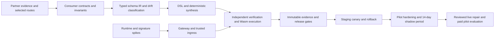

# Implementation Plan
# Self-Healing B2B API Mesh & Schema-Drift Compiler

**Status:** Proposed execution plan; no implementation is claimed.  
**Prepared:** 17 October 2026.  
**Source:** [Blueprint PDF](High-Moat%20Startup%20Blueprints%202026%20%281%29.pdf), especially pages 2, 5, and 8.  
**Companion documents:** [PRD](prd.md) · [Architecture](architecture.md).

**Navigate:** [At a glance](#plan-at-a-glance) · [Milestones](#2-critical-path-and-milestone-dependencies) · [Weekly schedule](#3-work-packages-and-weekly-schedule) · [Descope order](#31-capacity-reserve-and-descope-order) · [Feature traceability](#4-backlog-and-requirement-traceability) · [Verification](#6-verification-strategy) · [Capacity and cost](#8-capacity-and-cost-planning) · [Risks](#9-risks-dependencies-and-decision-triggers) · [R2 roadmap](#10-r2-roadmap-after-a-successful-pilot).

## Plan at a glance

Available capacity is 4 engineers × 5 days × 70% ≈ **14 engineer-days per week**. Each week's planned work is capped at about **12 engineer-days**, leaving roughly 2 engineer-days as schedule reserve. The cap is a budget, not a bottom-up estimate: each owner sizes their week's tasks against it during week 1, and the whole schedule is re-baselined at M0 using the week 1–2 spike results.

| Week | Focus | Key output | Gate / decision | Allocation cap (eng-days) |
|---|---|---|---|---|
| 0 (pre-start) | Customer discovery and partner commitment | Interview evidence, candidate routes, signed pilot LOIs | **W0** partner commitment | Founder + product (not counted below) |
| 1 | Contracts and repository foundation | Selected routes, invariants, local dev environment | Week 1 exit check | 12 |
| 2 | Runtime, signature, durability spikes | Feasibility report, latency results | **M0** feasibility and scope | 12 |
| 3 | Contract registry and drift detection | Typed IR, labeled detector evaluation | Week 3 exit check | 12 |
| 4 | DSL, synthesis, independent oracle | Deterministic compiler, native/Wasm equivalence | **M1** deterministic core | 12 |
| 5 | Durable jobs, replay isolation, release staging | Crash-resilient pipeline, scoped approvals | Week 5 exit check | 12 |
| 6 | Full prototype, canary, rollback; first shadow install | End-to-end Stripe demo, partner 1 shadow clock started | **M2** complete prototype + commercial check | 12 |
| 7 | Tenant isolation, identity, reference deployment | Isolation report, partners 2–3 shadow | Week 7 exit check | 12 |
| 8 | Operator UI, delivery ops, live signature qualification | Operator workflow, connector health | Week 8 exit check | 12 |
| 9 | Security, resilience, production eligibility | Fault matrix, restore drill, readiness record | **M3** production eligibility (earliest) | 12 |
| 10 | Reviewed production repairs and retirement | Reviewed repair report, shim retirement | Week 10 exit check | 12 |
| 11 | Performance, cost, onboarding, usage | Benchmark/cost report, fresh onboarding | Week 11 exit check | 12 |
| 12 | Pilot evaluation | Evidence-linked R1 acceptance, partner decisions | **M4** pilot completion | 10 + review |

If an owner's sized work for a week exceeds the cap, or the week overruns it in two consecutive weekly reviews, apply the [descope order](#31-capacity-reserve-and-descope-order) before moving any gate date.

## 1. Delivery strategy and assumptions

Deliver the smallest complete reliability loop first: observe an approved JSON route, detect a structural mismatch, synthesize a constrained adapter, verify it independently, deploy it in staging, and demonstrate rollback. Then harden the same loop for reviewed customer pilots. Broad protocol coverage and automatic production repairs follow evidence from those pilots.

The PDF suggests a six-week MVP and a 90-day validation cycle. Here, six weeks means a technical prototype, while weeks 7–12 produce a qualified pilot. Week 0 is a pre-start discovery period run by the founder/product lead; it can overlap hiring and onboarding and is not part of the 12-week engineering clock. Neither date overrides safety, correctness, or partner-access gates.

The schedule deliberately puts one connector on the critical path: **Stripe signed webhooks plus generic JSON** carry the M2 reference scenario. The Shopify webhook pack and NetSuite read-only fixture pack remain R0 deliverables per the PRD, but they are built on the same core after the Stripe path works and are the first connector work cut if capacity runs short.

### 1.1 Staffing and capacity assumption

| Role | Primary ownership | Capacity assumption |
|---|---|---|
| Runtime/platform engineer | Envoy, executor, agent, rollout, infrastructure | One full-time engineer |
| Compiler/verification engineer | Contract IR, DSL, synthesis, replay, property/fuzz tests | One full-time engineer |
| Backend/integration engineer | Control API, persistence, webhook service, provider packs, GitHub | One full-time engineer |
| Product/full-stack engineer | Partner discovery, CLI/console, operator workflows, product metrics | One full-time engineer |
| Founder/technical lead | Architecture decisions, customer selection, release decisions | May be one of the four; plan reserves coordination capacity |
| Security/SRE reviewer | Threat review, fault drills, deployment and access review | Part-time review capacity, scheduled before pilot |

The timetable assumes four experienced engineers, roughly 70% of nominal capacity available for planned implementation, and prompt access to provider test accounts. It is not credible as a six-week solo production build. With one or two engineers, prioritize generic JSON plus one signed webhook provider, postpone NetSuite/UI/GitHub expansion, and re-estimate approximately 16–24+ weeks after the first technical spike. Safety gates remain unchanged.

No production customer data, cloud account, provider sandbox, paid service, model, or repository installation is presumed available. The plan can start with synthetic fixtures and local tools; external dependencies have explicit owners below.

### 1.2 Scope and architecture baseline

- Rust compiler and Wasmtime executor; Go control plane, local agent, webhook service, and CLI; React/TypeScript console after the core demo.
- Envoy routes supported JSON traffic through a local ext_proc service. An embedded Proxy-Wasm proof is a comparative lab experiment.
- PostgreSQL stores authoritative state and delivery ledgers; NATS JetStream carries work via an outbox; encrypted S3 objects store artifacts and permitted local payloads.
- R0 supports a documented schema subset and deterministic operations. R1 requires a human approval for every new repair candidate.
- Start with Stripe/Shopify signed webhook fixtures and a NetSuite read-only REST fixture pack. Provider-specific live qualification depends on accounts, pinned versions, and selected operations.
- Keep eBPF, model proposals, unary gRPC/GraphQL repair, private control-plane features, and automatic policy-governed repair in R2.

See the [architecture stack table](architecture.md#3-selected-technology-stack) for component selections and [PRD feature catalog](prd.md#5-feature-catalog-and-acceptance-criteria) for product acceptance criteria.

## 2. Critical path and milestone dependencies



The console, notification integrations, and commercial reports can be built after the API contracts stabilize. Runtime host feasibility, signature semantics, replay safety, and release correctness are on the critical path and cannot be deferred to the end.

### 2.1 Milestones

| Milestone | Target | Required evidence | Decision |
|---|---|---|---|
| **W0: partner commitment** | Before week 1 starts | ≥10 interviews across ≥3 prospects, candidate routes with named owners, ≥2 signed pilot LOIs (non-binding) that include shadow-install access and a contact for consumer invariants | Start the engineering clock, or keep recruiting partners while running only technical spikes |
| **M0: feasibility and scope** | End of week 2 | Runtime benchmark, signature demo, selected contract subset, fixture access, deployment boundary; effort re-baseline against the weekly cap | Continue with qualified paths or narrow scope |
| **M1: deterministic core** | End of week 4 | Labeled drift detector, finite DSL, safe/unsafe fixture behavior, native/Wasm equivalence | Proceed to deployment work only with a trusted oracle |
| **M2: complete prototype** | End of week 6 | Stripe signed fixture → drift → compile → replay → staging canary → rollback; partner 1 observe-only shadow running; ≥1 partner has seen the demo and confirmed in writing its intent to proceed to a paid pilot if M3/M4 gates pass | Start customer pilot hardening; no automatic production patching. If no partner confirms intent, review positioning before spending weeks 7–12 on hardening |
| **M3: production eligibility** | End of week 9 at earliest; week 10 if reserve is consumed | Isolation/durability/security/fault gates and ≥14-day partner shadow evidence | Enable individually approved production routes |
| **M4: pilot completion** | End of week 12, if gates pass | Reviewed live/drill repair, operational runbooks, restoration measurement, costs, customer decision | Continue, narrow, or stop based on evidence |
| **M5: bounded automation** | R2, unscheduled | Repeated safe reviewed outcomes, broader corpus, independent review, explicit customer policy | Automate only qualified low-risk classes |

## 3. Work packages and weekly schedule

Tasks are ordered within each week. Different owners may work concurrently where the dependency table permits. Feature IDs refer to the PRD.

### 3.1 Capacity reserve and descope order

Each week keeps about 2 engineer-days of reserve (see [Plan at a glance](#plan-at-a-glance)). When the reserve is exhausted, the technical lead cuts scope in this order at the weekly review, recording each cut in the decision log and the R0/R1 known-limits list:

1. GitHub App source-integration flow (F17); export the DSL/evidence bundle as files instead.
2. Experimental Proxy-Wasm lab comparison; keep the local ext_proc + Wasmtime path only.
3. Console polish beyond the operator journey; keep CLI/API parity for every operator action.
4. Notification integrations; keep in-product alert state and audit records.
5. Shopify webhook pack beyond fixture-level tests.
6. NetSuite read-only fixture pack.

Items 5–6 are PRD R0 commitments, so cutting them requires a recorded PRD scope change agreed with the product lead. Never cut: signature verification, independent oracle, replay isolation, durable acceptance, tenant isolation, approval freshness, rollback/kill switch, or the 14-day shadow minimum. If those cannot fit, move the gate date instead.

### Week 0 (pre-start) — Customer discovery and partner commitment

**Owners:** Founder/technical lead and product/full-stack lead.  
**Features:** Inputs to F02, F09, F22; no engineering deliverables.

1. Interview at least ten integration engineers across at least three potential design partners. Collect incident timelines, repair time, provider/version, downstream effect, and a sanitized failing/passing example where allowed.
2. Shortlist candidate event families and operations per partner, each with a named owner who can define correct output. Record cases that require business decisions as out of scope.
3. Discuss payload locality, retention, signature trust boundary, deployment topology, and consumer contract ownership with each prospect so week 1 can confirm rather than discover them.
4. Agree non-binding pilot letters of intent with at least two partners covering shadow-install access, an invariant-owner contact, data handling expectations, and the evidence that would justify a paid pilot.
5. Request provider test accounts and NetSuite sandbox authorization early, since these have external lead times.

**Deliverables:** Interview notes with sanitized examples; candidate route shortlist; signed LOIs; outstanding access requests with owners.

**Exit check (W0):** At least two partners have signed LOIs, and at least one candidate Stripe route has a named invariant owner. Without this, run week 1–2 technical spikes only and keep recruiting; do not start pilot-specific work.

### Week 1 — Contracts, route selection, and repository foundation

**Owners:** Product/full-stack lead, compiler lead, runtime lead.  
**Features:** F01–F04, F09, F20, F22.

1. Confirm exact event families and operations from the week 0 shortlist. Prefer noncritical data fields with an owner who can define a correct output. Stripe routes go first; Shopify and NetSuite routes are selected but scheduled after the Stripe path.
2. Record agreed payload locality, retention, signature trust boundary, deployment topology, and consumer contract ownership with each partner. Document storage requirements before enabling durable webhook mode.
3. Each owner sizes their weeks 1–6 tasks against the weekly allocation cap and flags any overrun to the technical lead.
4. Define a synthetic mutation taxonomy and initial oracle independently of any synthesizer. Include rename/move, deletion, nullable/missing, incompatible types, enum change, unit change, auth, rate limiting, and pagination.
5. Create monorepo structure, build commands, lockfiles, linting, formatting, dependency scanning, CI smoke path, and Linux development images.
6. Define schemas for route, contract, observation, adapter DSL, verification manifest, release manifest, and internal event envelope. Reserve stable IDs and version fields.
7. Stand up local PostgreSQL, NATS, filesystem object storage, provider simulators, Envoy, and basic health/metrics endpoints.

**Deliverables:** Selected-route list; explicit consumer invariants; fixture provenance manifest; architecture decision record updates; runnable local development environment; version compatibility record; sized task list per owner.

**Exit check:** Another developer can launch the simulator and collect a redacted request without external accounts. There is at least one repairable and one intentionally unsupported case for each chosen connector family. No observed sample is promoted to an authoritative contract automatically.

### Week 2 — Runtime, signatures, and data-boundary spikes

**Owners:** Runtime lead and backend/integration lead.  
**Features:** F02, F03, F10, F12, F14, F15, F20.

1. Implement one identity/no-op and one guarded field-move transform in the shared Rust core. Run them through the proposed core Wasm ABI in Wasmtime.
2. Build a local ext_proc integration. Test full bounded bodies, HTTP/2 concurrent streams, empty responses, chunking, timeouts, malformed JSON, and body/header consistency.
3. Measure pass-through versus transform latency on the declared 4-vCPU/8-GiB Linux profile. Record architecture, toolchain, payload distribution, warm/cold behavior, concurrency, CPU, memory, and p50/p95/p99.
4. If reserve allows, attempt the same logical adapter through Proxy-Wasm in an isolated Envoy lab profile; record differences, restrictions, and artifact identities. Do not make it the default based on a single successful request. This is descope item 2 and does not block M0.
5. Verify original Stripe signatures with provider tooling/test fixtures, mutate the body to demonstrate signature failure, and demonstrate the new mesh trust contract after verification. Record any Shopify-specific raw-body/HMAC differences for the week 6 Shopify fixture pack.
6. Prototype object-store-first plus ledger-commit durable acceptance. Inject crashes before storage, before DB commit, after DB commit, and before the provider receives success.
7. Test local redaction/export boundaries with seeded secret strings. Distinguish incomplete bodies and unsupported content encodings.
8. Confirm NetSuite sandbox availability and exact read-only operation. If unavailable, keep R0 fixture-based and record the live qualification dependency.
9. Record partner Linux/kernel/TLS-library prerequisites for future eBPF capture; no production agent implementation is required for this milestone.

**Deliverables:** Feasibility report; host/ABI decision; original-signature and mesh-signature fixtures; latency results; durable-acceptance crash matrix; supported-body policy.

**M0 gate:** No unexplained body corruption, unbounded execution, or signature ambiguity. The primary runtime path has a credible route to the latency budget. If it fails, narrow traffic/transform scope or revisit architecture before building the full release system.

### Week 3 — Contract registry, inference, and incident detection

**Owners:** Compiler lead and backend/integration lead.  
**Features:** F03–F06, F09, F18, F22.

1. Implement bounded OpenAPI/JSON Schema loading and the typed IR. Support the declared keyword subset and reject unsupported proof-relevant constructs with diagnostics.
2. Add contract versions, normalized hashes, source provenance, and published consumer bindings.
3. Build observed-shape extraction that preserves missing/null, union branches, arrays, and exact numeric types. Store confidence and coverage separately from contract truth.
4. Partition drift detection by route, provider version, direction, and event family; implement semantic/structural/operational incident classes.
5. Implement incident fingerprinting, provisional/confirmed states, first/last seen, owner, capture quality, and evidence references.
6. Add API/CLI commands to import a contract, inspect drift, view incident details, and mark a mapping annotation reviewed.
7. Add schema/ref/regex/depth limits and ensure external references cannot fetch arbitrary network locations.

**Deliverables:** Contract registry; CLI incident view; labeled detector evaluation; supported-keyword matrix; redaction and unsupported-content reports.

**Exit check:** At least 50 labeled structural/operational fixture scenarios are classified as expected. A 401, 429, business decline, HTML error, or truncated body does not become an automatic schema patch. An added field is breaking only where the consumer contract makes it so.

### Week 4 — DSL, deterministic synthesis, and independent oracle

**Owner:** Compiler/verification lead, supported by integration lead.  
**Features:** F07, F09, F10, F11, F22.

1. Implement `copy`, `move`, authorized `remove`, `assert`, guards, and typed composition. Define path conflicts, missing/null behavior, array bounds, and output contract checking.
2. Implement a bounded candidate search over approved mapping annotations; surface ambiguity and search exhaustion instead of selecting a guess.
3. Generate Rust adapter code from audited templates and validated constants, compile offline with pinned dependencies, and record artifact provenance.
4. Build the replay oracle from customer contracts, independently authored assertions, and golden outputs. Keep a holdout set unavailable to synthesis.
5. Run equivalence tests between the native core and production Wasm wrapper, including >53-bit integers, identifier strings, empty/null values, unicode, and malformed payloads.
6. Implement deterministic execution, preserved-field, collision-rejection, resource-limit, and negative-case properties.
7. Write the evidence manifest schema and low-volume waiver policy. Implement static policy checks before exposing an approval action.

**Deliverables:** Working deterministic compiler; native/Wasm equivalence report; evidence manifest; golden/negative/property tests; candidate explanations.

**M1 gate:** Safe fixture mappings are correct according to an independent oracle. Missing business data, ambiguous renames, overflow, lossy conversion, and protected-field changes are rejected. Repeated builds have measured reproducibility; unexplained differences block immutable-release claims.

### Week 5 — Durable jobs, replay isolation, and release staging

**Owners:** Backend/integration lead and runtime lead.  
**Features:** F10–F14, F19, F20.

1. Implement PostgreSQL outbox/inbox, JetStream dispatch, leases with fencing revisions, bounded retry, and duplicate-result handling.
2. Run build/replay jobs in disposable, nonroot, egress-denied environments. Verify that neither production provider URLs nor customer destinations are reachable.
3. Implement encrypted local event objects, event ledger/dedupe keys, delivery leases, transformed-output persistence, and basic DLQ behavior.
4. Produce signed verification manifests and artifacts. Implement agent cache, trust-store checks, tenant/environment binding, ABI/runtime compatibility checks, and monotonic release generations.
5. Implement exact-tuple approval, expiry, policy recheck, stale-revision rejection, and release staging/warming.
6. Add xDS version/nonce/ACK/NACK tracking and separate observed executor health. Demonstrate a NACK, missing artifact, and partial local readiness block assignment.

**Deliverables:** Crash-resilient work pipeline; isolated replay; authenticated artifact installation; scoped manual approval; staging release path.

**Exit check:** Crashes and redeliveries do not lose committed work or create conflicting candidate states. A stale or modified approval cannot release. A duplicate accepted webhook is not sent as a new logical event.

### Week 6 — Full prototype, canary, rollback, and first shadow install

**Owners:** Runtime lead and product/full-stack lead; backend/integration lead for the shadow install.  
**Features:** F02–F07, F09–F15, F18–F20, F22.

1. Implement per-request/event artifact pinning and a staging canary with deterministic cohorts.
2. Add rollout health gates, halt, rollback, quarantine, and local emergency commands.
3. Exercise the full reference scenario end to end with Stripe signed fixtures and generic JSON. Label synthetic mutation examples clearly.
4. Run the Shopify signed-webhook fixtures and NetSuite read-only fixture responses through the same pipeline. These connector packs are descope items 5–6; a gap here is recorded in the known-limits list and does not block the Stripe-based M2 gate.
5. Build minimal CLI/API report views for incidents, evidence, approvals, releases, and queues. Avoid spending the core milestone on a polished dashboard.
6. Run the default verification execution count with distinct cases, holdout and negative-case reporting. Exercise a low-volume waiver without enabling automatic promotion.
7. Measure latency at target load, boundary body size, capture pressure, and executor resource exhaustion. Publish limitations and failure-policy outcomes.
8. Install an observe-only, single-tenant data plane at partner 1 within the deployment boundary agreed at M0: no payload export beyond the agreed manifest, no transforms on live traffic. This starts partner 1's 14-day shadow clock with roughly one week of slack before M3. If the partner is not ready, install no later than early week 7; any later install moves partner 1's production gate.
9. Demo the prototype to each LOI partner and ask for written confirmation of intent to proceed to a paid pilot if M3/M4 gates pass.

**Deliverables:** Reproducible end-to-end demo; recorded acceptance report; operator quickstart; R0 known-limits list; partner 1 shadow install record; partner demo feedback and intent confirmations.

**M2 gate:** A signed synthetic Stripe event is accepted correctly, structural drift is diagnosed, the adapter passes independent checks, a scoped staging approval releases it, a deliberate regression halts rollout, and rollback or quarantine behaves as declared. No external writes occur during verification replay. Commercially, at least one partner has confirmed intent to proceed; otherwise the founder reviews positioning and partner selection before committing weeks 7–12 to hardening.

### Week 7 — Tenant isolation, identity, and partner shadow expansion

**Owners:** Backend/integration and runtime leads; security reviewer.  
**Features:** F01–F04, F11, F14, F19, F20, F25.

1. Add production OIDC login, scoped service identities, environment RBAC, author/approver separation, and session/CSRF handling.
2. Enforce tenant-aware foreign keys, RLS with non-owner roles, certificate-derived scope, object-store policy, and tenant-bound artifact/evidence access.
3. Set up reference hosted control infrastructure and customer-hosted data plane with managed secrets, mTLS rotation, backups, and egress policies.
4. Continue partner 1's shadow/recommend period and begin shadow periods for partners 2–3 where installs are ready. Every partner needs at least 14 days from its own start date; a later installation moves that partner's production gate.
5. Test telemetry retention and ensure accepted-event retention is independently configured. Review the data export manifest with each partner.

**Deliverables:** Tenant-isolation test report; reference deployment; partner shadow evidence to date; production identity and data handling runbooks.

**Exit check:** Cross-tenant API, job, object, and artifact access attempts fail. Disconnected agents show stale status and cannot receive new releases.

### Week 8 — Operator UI, delivery operations, and integration health

**Owners:** Product/full-stack and backend/integration leads.  
**Features:** F06, F14–F16, F18, F20.

1. Build the operator console: inventory, incident detail, candidate diff, replay report, approval, deployment, queue/DLQ, and settings. Console polish beyond this journey is descope item 3.
2. Add keyboard navigation, clear environment labeling, masked payload views, accessible diff states, and visible unknown/stale/insufficient-evidence states.
3. Qualify signature verification, raw-byte handling, provider/account identities, durable admission watermarks, timestamp policy, and event dedupe with live test accounts.
4. Implement bounded webhook retry, downstream acceptance tracking, manual redelivery review, dedupe tombstones, and oldest-event/expiry alerts.
5. Add provider authentication health, configured token refresh with single-flight leases, rate-limit scheduling, and read-only retry policies.
6. Add pagination loop/duplicate/no-progress diagnostics and multi-page test sequences. Do not ship pagination rewriting in R1.

**Deliverables:** Usable operator workflow; live signature qualification record; delivery runbook; connector health dashboard; ongoing partner evidence.

**Exit check:** An operator can resolve the reference incident using only product UI/API and documented commands. Provider signature failures from live test accounts cannot reach the transform/delivery stage. Unknown outcomes and capture loss are visible; no swallowed failure creates a false healthy state.

### Week 9 — Security, resilience, and production eligibility

**Owners:** Runtime lead, compiler lead, and security/SRE reviewer.  
**Features:** F09–F15, F19, F20, F25.

1. Run tenant isolation, artifact substitution, malicious schema/payload, SSRF, parser-limit, and Wasm host/resource tests.
2. Inject outages: control DB, NATS, collector, object store, local event ledger, executor, downstream endpoint, agent connection, and one zone/node.
3. Demonstrate no acknowledged event loss under the stated single-failure model; verify uncertain downstream acknowledgements lead to same-identity retry.
4. Restore control metadata and local delivery state from backups. Measure RPO/RTO and reapply deletion tombstones before exposing restored data.
5. Check 14-day partner shadow records: classification precision, unsupported cases, false alerts, coverage, resource use, and operator feedback.
6. Approve specific production route/candidate combinations only after all relevant gates pass. Keep other routes in observe/recommend mode.

**Deliverables:** Fault matrix; restore drill report; security review outcomes; route-by-route production readiness record.

**M3 gate:** No unresolved critical correctness/security finding; runtime and delivery SLO candidates measured; rollback/local kill switch work; signatures and consumer trust are qualified; partner shadow minimum met. A six-week demo alone is insufficient.

### Week 10 — Reviewed production repairs, source integration, and retirement

**Owners:** Integration/backend and product leads; runtime lead on rollout.  
**Features:** F11–F13, F17, F22, F26.

1. Run individually approved canaries on eligible partner routes. Require minimum traffic and duration; sparse routes remain paused or use an explicitly reviewed narrower rollout.
2. Exercise controlled recovery from a real incident or a partner-approved synthetic mutation drill. Label drills separately from naturally occurring incidents in metrics.
3. Add GitHub App installation flow with selected-repository scope, safe PR content, idempotency, base/head tracking, webhook validation, and conflict behavior. This is descope item 1; if cut, export the same bundle as downloadable files.
4. Export DSL, generated integration example, safe fixtures, evidence manifest, and rollout link into the PR. Do not copy raw production data into source control.
5. Implement permanent-fix verification, consumer version/attestation, no-op canary, and shim retirement. Add active-adapter review reminders without automatic expiry removal.
6. Populate tenant-local mutation patterns from reviewed cases and their failure labels.

**Deliverables:** Reviewed repair report; optional source PR workflow; documented shim retirement; labeled pattern library.

**Exit check:** Live events have traceable artifact identity. A merged PR does not retire a shim until deployed-consumer compatibility is shown. GitHub unavailability does not change live delivery behavior.

### Week 11 — Performance, cost, usage, onboarding, and support readiness

**Owners:** Runtime and product leads; backend/integration lead for usage and notifications.  
**Features:** F02, F18–F21, F25.

1. Repeat the qualified latency/load benchmark after hardening, because new authentication and telemetry code may affect results. Run soak and overload tests with measured memory stability.
2. Implement usage events for protected, transformed, verified, and downstream-accepted outcomes; dedupe event-based charges and record retries separately. Backfill from week 10 delivery records where available.
3. Configure notifications only to customer-selected destinations, with grouping, cooldown, and safe metadata. Notification integrations are descope item 4; in-product alert state remains required.
4. Calculate bytes/event, retained storage, executor CPU, verification cost, notification/API cost, and engineering support burden using actual pilot usage.
5. Tune sample budgets, safe quotas, retention, worker concurrency, and database indexes without reducing correctness gates.
6. Make onboarding reproducible for a fresh tenant/environment; verify identity revocation, connector removal, and tenant deletion.
7. Complete installation/upgrade/rollback runbooks, known compatibility matrix, incident escalation, and support ownership.
8. Agree a paid-pilot proposal using the validated value and cost model. Exact pricing remains a business decision grounded in these measurements.

**Deliverables:** Benchmark/cost report; first usage report; deployment and operator documentation; tested fresh onboarding/deletion; paid-pilot proposal inputs.

**Exit check:** Post-hardening latency and soak results meet the qualified targets or have documented, accepted limits. A duplicate delivery is counted once in usage. Cross-tenant notification access fails and alert content contains no payload secrets. A new engineer onboards a fresh tenant from the runbook alone, and tenant deletion leaves only permitted audit metadata. Each partner has received a paid-pilot proposal.

### Week 12 — Pilot evaluation and next-release decision

**Owners:** Product/founder lead with all engineering owners.  
**Features:** All R1 slices.

1. Evaluate precision/recall on labeled cases, eligible repair coverage, restoration-time change, unsafe releases, unsupported cases, capture gaps, and operator effort.
2. Confirm all R1 feature acceptance checks have evidence links and no hidden unfinished dependency.
3. Review each partner's actual willingness to pay against its week 0 LOI and M2 intent confirmation, and whether the product reduces work beyond diagnosis alone.
4. Reconcile incident reports, deployment records, and usage invoices/reports so “transformed” is never presented as proven business correctness.
5. Conduct a release review and choose the next narrow expansion based on failure data and customer demand.

**M4 gate:** At least two partners willing to pay is the initial commercial target, not an engineering completion guarantee. If technical correctness passes but demand does not, investigate positioning or scope before increasing infrastructure breadth. If unsafe repairs occur, freeze expansion and address the failure class first.

## 4. Backlog and requirement traceability

The table ensures every PRD feature has an owner, milestone, and verification method. R2 rows are planned work, not included in the 12-week commitment.

| Feature | Primary owner | First milestone / remaining slice | Verification |
|---|---|---|---|
| F01 Tenancy and roles | Backend | R0 local identity; M3 OIDC/RBAC | Cross-tenant/environment and self-approval denial tests |
| F02 Onboarding/inventory | Integration + product | M0 route setup; M4 repeatable onboarding | Fresh-tenant install, unsupported-route and secret-reference checks |
| F03 Capture/privacy | Runtime | M0; M3 hardening | Redaction canaries, capture loss, bounded-buffer and latency tests |
| F04 Registry/inference | Compiler | M1 | Dialect fixtures, required/null semantics, unsupported keyword checks |
| F05 Detection/classification | Compiler + backend | M1 | Labeled structural/operational mutation benchmark |
| F06 Incident/impact workspace | Product + backend | M1 CLI; M3 UI | Incident grouping/version separation and affected-route scenario |
| F07 Deterministic synthesis | Compiler | M1 | Unique safe mapping accepted; ambiguous/lossy mapping rejected |
| F08 Model proposals | Compiler | R2 | Held-out evaluation, export policy, hostile input, model-off parity |
| F09 Invariants/policy | Compiler + route owner | M1; M3 hardening | Schema-valid but semantically wrong output rejected |
| F10 Build/replay | Compiler + runtime | M2; M3 isolation | Offline build, network-denied replay, holdout and resource tests |
| F11 Approval | Backend | M2; M3 role/freshness enforcement | Exact-tuple, stale/expired/policy-changed denial |
| F12 Runtime/rollout | Runtime | M2; M3 production gate | Pinning, partial propagation, canary/latency tests |
| F13 Recovery | Runtime + SRE | M2; M3 fault gate | Rollback, local kill switch, incompatible-prior quarantine |
| F14 Signed durable delivery | Integration | M2; M3 hardened | Raw-byte signature, crash windows, dedupe, ambiguous ACK tests |
| F15 Retry/auth/limits | Integration | M3 | No duplicate unsafe writes; backoff and token-refresh race tests |
| F16 Pagination | Integration | M3 diagnostics; R2 repair | Loops/duplicates/checkpoints in multi-page fixtures |
| F17 GitHub | Backend + product | M4 | Scoped installation, safe PR, retry/conflict/merge behavior |
| F18 UI/CLI/API/alerts | Product | M2 CLI; M4 full R1 | End-to-end operator journey, keyboard flow, safe alert content |
| F19 Audit/retention/deletion | Backend + SRE | M2 metadata; M4 full R1 | Release evidence completeness, TTL, deletion, restored tombstones |
| F20 Observability/resilience | Runtime + SRE | M0 metrics; M4 operations | Fault drills and SLO measurement |
| F21 Usage/quotas | Backend + product | M4 | Duplicate delivery accounting and storage admission behavior |
| F22 Mutation corpus | Compiler | M1 fixtures; M4 tenant library; R2 sharing | Provenance, consent, reuse still requires local verification |
| F23 eBPF | Runtime | R2 | Kernel/library matrix, lost-message reporting, overhead |
| F24 Expanded protocols | Compiler + integration | R2 | Separate descriptor/operation qualification suites |
| F25 Private/enterprise | Platform | M3 local data plane; R2 private control/SSO extensions | Egress/residency, identity revocation, dedicated deployment restore |
| F26 Retirement | Runtime + integration | M4 | Permanent fix deployed, no-op canary, safe cache/artifact retention |

## 5. Repository and implementation structure

Proposed layout to create during implementation; these paths do not currently exist merely because they appear here:

```text
apps/
  console/                  # React/TypeScript operator UI
cmd/
  control-plane/            # Go management API and reconciler
  worker/                   # Go control-plane background workers
  agent/                    # Go customer data-plane agent
  webhook/                  # Go ingress and delivery service
  meshctl/                  # Go CLI
internal/
  tenancy/ contracts/ incidents/ approvals/ releases/
  delivery/ providers/ audit/ usage/ outbox/ storage/
crates/
  contract-ir/              # Schema normalization and compatibility
  adapter-dsl/              # Parsing, typing, effect analysis
  adapter-core/             # Pure deterministic operations
  adapter-compiler/         # Candidate search and code generation
  adapter-wasm/             # Production core Wasm ABI wrapper
  adapter-proxy-wasm/       # Experimental embedded host wrapper
  executor/                # Local ext_proc + Wasmtime
  verifier/                # Independent assertions, replay, properties
proto/                     # Agent RPC and versioned internal contracts
schemas/                   # DSL/manifests/API schemas
connectors/
  stripe/ shopify/ netsuite/ generic-json/
fixtures/
  synthetic/ golden/ negative/ sequence/
  manifests/               # Provenance and holdout split metadata
migrations/                # Control and local-delivery SQL migrations
deploy/
  compose/ helm/ terraform/ envoy/
benchmarks/                # Repeatable latency/capture/replay workloads
tests/
  integration/ e2e/ isolation/ chaos/
docs/                      # Product/design/operations documentation
```

Keep pure transformation code independent of network/storage libraries. Share semantic test fixtures across wrappers. Do not share production credentials, tenant payloads, or partner-owned schemas in a public fixture directory. Define one owning module for each state transition to prevent contradictory update paths.

### 5.1 API and schema evolution

- Publish API, RPC, DSL, event, and manifest schemas before consumers depend on them.
- Prefer additive changes within a version; reject unknown critical manifest/DSL fields instead of silently dropping them.
- Pin provider versions in connector manifests, with upgrade fixtures and an explicit deprecation window.
- Use expand/contract database migrations; an older deployed agent must either remain supported or receive a clear upgrade-required state.
- Maintain a compatibility table for Go/Rust toolchains, Envoy build/runtime, Wasmtime, Wasm ABI, and each connector pack. CI runs the supported combinations, not every possible version.

### 5.2 Required Git branch, commit, merge, and push workflow

Every change must follow this workflow before it is pushed to `main`:

1. **Create a new branch first.** Start from the current `main` and create a descriptive feature, fix, or documentation branch, such as `feat/schema-drift-detector`. Make the changes and commits on that branch.
2. **Keep commits logical.** Each commit should represent a coherent change with a clear message.
3. **Group excessive commits before merging.** If the branch accumulates many small, WIP, fixup, or repetitive commits, squash them into one or a few logical commits. Preserve separate commits for meaningful independent changes. Clean up the branch history before merging; do not rewrite history already merged into `main`.
4. **Validate the finished branch.** Incorporate any newer changes from `main`, resolve conflicts, and run the checks appropriate to the change. Rerun affected checks after conflict resolution or history cleanup when the resulting content changes.
5. **Merge into `main`.** Merge the completed, validated branch using the repository's merge process.
6. **Push the merged `main`.** Push `main` to the configured remote after the merge. If the remote has advanced, reconcile those changes and validate the result before retrying the push.

Required order: **new branch → changes and commits → group/squash excessive commits → validate → merge into `main` → push `main`**.

## 6. Verification strategy

### 6.1 Test layers

| Layer | Required cases | Gate |
|---|---|---|
| Parser/IR unit tests | Missing/null, unions, `$ref`, unsupported dialects, duplicate keys, exact numbers, depth | Contract import or inference cannot erase semantics |
| DSL/static tests | Invalid pointers, collisions, cycles, ambiguous moves, unauthorized removal/defaults | Unsafe plan cannot compile |
| Property/fuzz tests | Determinism, preserved fields, integer/decimal boundaries, malformed input, bounded resources | No unexplained mutation/crash or unbounded execution |
| Host equivalence | Native versus core Wasm; Proxy-Wasm if offered | Same semantic output/rejection on the qualified corpus |
| Provider integration tests | Raw signature bytes, version extraction, event identity, permissions, error shapes | Connector pack is qualified for selected families only |
| Replay safety | Network deny, no provider/consumer side effects, independent oracle, holdout | Evidence cannot validate itself or trigger business actions |
| Durable delivery tests | Each crash window, duplicate and changed-body event IDs, lost downstream ACK | No acknowledged loss in the modeled failure case; stable retry identity |
| Release tests | Stale policy/contract/evidence, approval mutation, NACK, partial rollout, disconnected node | Unqualified artifacts cannot receive traffic |
| Security/isolation tests | Tenant spoofing, object/job access, SSRF, secrets, model instructions if later enabled | No cross-boundary data or authority transfer |
| Performance/soak | 500 requests/s target, 32 KiB benchmark, 256 KiB boundaries, capture/queue pressure | Qualified overhead, memory stability, explicit overload behavior |
| Disaster recovery | Restore DB/objects/agent config, replay outbox, apply deletion tombstones | Measured RPO/RTO and operator runbook |
| User workflow | Onboard → investigate → verify → approve → release → recover → retire | Clear usable states and audit trail across the entire journey |

### 6.2 Evaluation dataset rules

1. Label the truth before running synthesis. Include unsupported semantic changes and operational errors so precision is not measured only on easy examples.
2. Keep distinct event/entity/time cohorts between generation and holdout; repeated copies of one event do not count as unique evidence.
3. Record synthetic, sanitized-real, and raw-local data separately. Redaction-induced gaps reduce confidence and are visible.
4. Apply the architecture's default release policy: 1,000 executions, at least 100 distinct real/sanitized events including 20 held out, coverage of declared variants, and at least 50 negative/adversarial cases. Report actual counts per candidate.
5. A prototype without partner events can demonstrate synthetic correctness but cannot claim the R1 production-evidence gate. A low-volume human waiver is explicit and never enables automatic repair.
6. Any protected-invariant failure blocks release. No aggregate pass percentage offsets a single critical assertion failure.
7. Version the dataset manifest, oracle, seed, compiler, runtime, and policy so results can be reproduced.

### 6.3 CI/CD pipeline

**Every source change:** format/lint → relevant unit/static tests → compiler/host equivalence → schema/API compatibility → integration smoke path → secret/dependency scan.

**Release candidate:** full mutation/holdout suite → parser/resource fuzz regression corpus → Linux runtime matrix → signed-webhook and durability scenarios → isolation tests → load/soak → reproducible artifact/provenance check → staged rollout/rollback drill.

**Promotion:** build once; sign and promote the same immutable digest through environments. Store source SHA, dependency lockfiles, image/module digests, SBOM, tests, and reviewer identity. Never rebuild a “matching” adapter independently for production without re-verification.

Run lengthy fuzz/soak jobs on scheduled or release paths rather than making every documentation edit wait for them. Add focused regression cases for actual discovered failures; do not write tests that only restate an implementation detail.

## 7. Operational deliverables and runbooks

Before enabling R1 production routes, supply and rehearse:

| Runbook | Required steps/evidence |
|---|---|
| New connector/route | Verify source version, owner contract, signature/trust mode, secrets, destination, retention, capture coverage |
| Suspected bad repair | Halt promotion, identify digest/affected events, stop new assignments, rollback or quarantine, assess downstream effects |
| Stale/disconnected agent | Check local health and cache, stop promotion, use authenticated emergency control, reconcile desired/observed generation |
| Signature/credential failure | Preserve safe diagnostics, rotate/reference secrets, validate test event, prevent bypass or retry storm |
| Queue backlog/DLQ | Diagnose age/attempts/quota/downstream state; preserve event identity; review redelivery; notify before retention expiry |
| Provider rate limiting | Identify quota scope, enforce bounded schedule, respect deadlines, preserve read/write safety |
| Storage pressure | Drop only optional telemetry first; enforce webhook admission before acknowledgement; never delete active referenced artifacts |
| Key/certificate rotation | Overlap valid keys, verify tenant binding and receivers, remove old trust after confirmed migration |
| Database/object restore | Measure backup point, restore ledger/objects, replay outbox idempotently, apply deletion tombstones, reconcile uncertain deliveries |
| Tenant deletion | Revoke access, stop jobs/routes, delete live objects/indexes/queues, retain permitted audit metadata, record backup expiry |
| Shim retirement | Verify consumer deployment and target contract, run no-op canary, remove assignment, retain rollback artifacts for policy window |

Assign primary/backup on-call owners and explicit incident severity levels during pilot. An invariant violation, cross-tenant exposure, or accepted-event loss is a release-freezing incident. A telemetry sample drop is a coverage incident with different operational urgency.

## 8. Capacity and cost planning

These are sizing assumptions and formulas, not vendor price quotes. Obtain current regional prices during infrastructure setup and replace assumptions with measured pilot values.

### 8.1 Pilot capacity envelope

- Three design partners; initially up to ten qualified routes each.
- Qualification target: 500 requests/s per 4-vCPU/8-GiB gateway/executor pair at 32 KiB JSON, with separate measurements for the 256 KiB limit.
- Default normal telemetry sampling 1%, anomaly sampling elevated within the daily budget.
- Initial telemetry cap 20 GiB/day per tenant, local telemetry spool 10 GiB, raw telemetry retention 24 hours.
- Webhook operational storage sized separately from telemetry: accepted events cannot be discarded to meet the sample budget.
- At most two concurrent verification jobs per tenant initially; 1,000 executions/job as the baseline workload, with queue fairness and tenant limits.

### 8.2 Cost model

```text
monthly infrastructure cost =
  gateway/executor compute
  + control API and worker compute
  + PostgreSQL and backup storage/IO
  + JetStream storage and replicated compute
  + object storage, requests, retention and egress
  + observability retention
  + KMS/secret operations
  + verification build/CPU cost
  + optional model cost (zero when disabled)

sample bytes/day = calls/second × 86,400 × mean captured bytes × sample fraction
pending delivery bytes = accepted events/second × mean body bytes × pending seconds
unit cost = attributable monthly cost / protected calls or accepted logical events
```

At 500 requests/s and 32 KiB, 1% sampling is approximately 13.2 GiB/day before replication/encryption overhead; 100% capture is approximately 1.29 TiB/day. Request-plus-response capture can double the volume. Use these figures to justify selective capture rather than storing every payload indefinitely.

Track gross-margin inputs and support hours for each pilot. Usage limits may stop optional capture or new expensive replay jobs; they must not silently disable a valid active adapter or discard an acknowledged event. Commercial overages need explicit customer terms rather than accidental runtime failure.

## 9. Risks, dependencies, and decision triggers

| Risk / dependency | Mitigation | Owner / trigger |
|---|---|---|
| Silent semantic corruption despite schema validity | Independent invariants, protected fields, held-out cases, human approval, unsupported outcome | Compiler lead; any violation blocks release |
| Insufficient partner evidence | Week 0 discovery and LOIs; synthetic benchmark plus clearly labeled real-data gap; no autonomous gate; recruit alternative partner | Product lead; W0 and week 2/4 review |
| Envoy/Wasm/runtime incompatibility | Pin compatibility matrix; default local Wasmtime; separate Proxy-Wasm qualification | Runtime lead; M0 |
| Performance misses | Profile parse/copy/serialization and local transport; narrow body/operation scope; remeasure | Runtime lead; M0/M2/M3 |
| Signature-breaking integration design | Verify raw bytes before transform; require mesh consumer trust or post-verification integration | Integration lead; M0 |
| Duplicate writes or replay side effects | Egress-denied verification, stable event IDs, receiver inbox protocol, read-only outbound pilot | Integration lead; M2/M3 |
| Hotfix loses safety during partial rollout | Per-event pinning, generation/freshness checks, actual health feedback, local kill switch | Runtime lead; M2/M3 |
| Privileged eBPF agent delays adoption | Keep it outside the pilot critical path; proxy/app-boundary mode first | Platform lead; R2 scope review |
| NetSuite account/schema access unavailable | Fixture pack in R0; live support label withheld until separately authorized sandbox qualification | Integration lead; week 2 |
| Provider endpoint/API version changes | Pinned connector versions, version cohorts, upgrade fixtures and compatibility policy | Integration lead; every connector release |
| Payload privacy or residency conflict | Local data plane, minimum export, explicit operational-storage choice | Product + security; before install |
| Build/artifact supply-chain compromise | Offline templates, dependency pinning, signed manifests, isolated jobs, provenance | Platform + compiler; M2/M3 |
| Sparse canary traffic | Both time/count gates, explicit human decision, no timer-only promotion | SRE + route owner; every release |
| Scope exceeds four-person capacity | Weekly allocation cap with reserve; apply the [descope order](#31-capacity-reserve-and-descope-order); preserve end-to-end safety core; extend dates rather than cut safety gates | Technical lead; weekly review and M0 re-baseline |
| Three-language stack (Rust, Go, TypeScript) strains a four-person team | Keep Rust confined to compiler/executor crates behind a stable ABI; Go owns control plane and services; defer console TypeScript until week 8; require cross-review only at language boundaries | Technical lead; revisit at M0 if any owner is blocked on an unfamiliar language for more than two days |
| Weak willingness to pay | Signed LOIs before week 1; written intent after the M2 demo; measure repair labor/time saved and buyer budget; do not hide poor demand with more features | Founder/product; W0, M2, M4 |

Dependencies to obtain: provider test accounts, NetSuite sandbox authorization, customer-selected webhook destinations, OIDC test tenant, reference cloud account, customer local deployment access, GitHub App registration/installation where desired, and owner-authored semantic invariants. These are implementation prerequisites, not actions already performed by writing this plan.

## 10. R2 roadmap after a successful pilot

| Workstream | Features | Prerequisite | Definition of done |
|---|---|---|---|
| Bounded automatic repair | F07, F09–F13 | Repeated safe reviewed outcomes, low-risk class, preauthorized tenant policy | Exact same evidence gates plus tested automatic halt/rollback; no ambiguous/critical mapping |
| Optional model assistance | F08 | Deterministic coverage baseline and approved data boundary | Higher safe proposal coverage on held-out corpus, reproducible evaluation, model-off behavior |
| eBPF observation | F23 | Clear demand for observation without app changes, supported Linux fleet | Qualified kernel/TLS matrix, complete-message reporting, bounded overhead, safe detach |
| Pagination repair | F16 | Provider sequence semantics and multi-page evidence | No-loss/no-duplication proofs within stated contract, checkpoint recovery, reviewed rollout |
| Unary Protobuf/GraphQL operations | F24 | Named customer operations and descriptors/schemas | Protocol-specific compiler, fixtures, limits, and compatibility classification |
| Private control plane/enterprise | F25 | Customer demand and operational support capacity | Repeatable private deployment, identity/rotation, backup/restore, upgrade compatibility |
| Shared mutation corpus | F22 | Explicit customer consent and abstraction quality review | No tenant data leakage; reusable template improves measured local verification outcomes |
| Analytics scaling | F20, F21 | PostgreSQL query/retention pressure demonstrated | ClickHouse projection with replayable ingestion and reconciled counts; no authoritative release state moved there |
| Embedded Proxy-Wasm | F12 | Host security/performance qualification | Separate supported ABI/runtime, differential tests, resource/failure guarantees, operational rollout |
| Reviewed outbound writes | F15, F24 | A specific provider operation has proven idempotency and reconciliation | Ambiguous outcome handling, preserved idempotency key, no automatic duplicate write |

Do not commit all R2 streams at once. Select the next one or two based on pilot failure distribution and customer willingness to deploy/pay.

## 11. Final definition of done

An R1 pilot is ready only when:

- Every R1 feature slice has an owner, implemented behavior, acceptance evidence, and documented limits.
- All supported traffic and connector claims match the compatibility matrix; experimental routes are labeled.
- An authorized customer can onboard, observe, diagnose, verify, approve, deploy, roll back/quarantine, and retire a repair through documented product interfaces.
- Signature authenticity, consumer trust, tenant isolation, durable acceptance, idempotency, replay isolation, invariant checking, and stale-release protection have passed meaningful tests.
- Performance and availability objectives have measurement reports; unsupported claims and unmeasured guarantees are removed from product copy.
- Operational runbooks, alert ownership, rollback artifacts, backup restoration, retention/deletion, and upgrade procedures are rehearsed.
- Each partner has completed its shadow period and approved the exact production route scope.
- Business outcomes distinguish real incidents, synthetic drills, transformed calls, downstream acceptance, and independently verified correctness.

The next executable step is week 0: run partner discovery, secure at least two pilot LOIs, and request provider/sandbox access. Week 1 then confirms the first exact routes and invariant fixtures, establishes the repository/runtime baseline, and begins validating the critical runtime/signature design before expanding the product surface.
